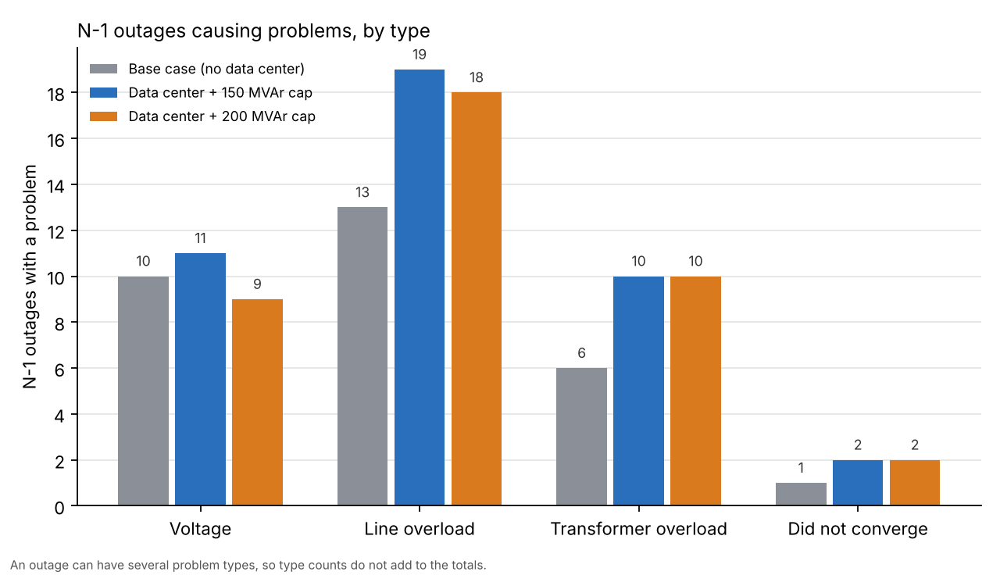

# Data center interconnection study: N-1 contingency analysis with pandapower

Study of adding a 300 MW data center at bus 242 to the supplied 500-bus transmission case:
base case, N-0, N-1 (all lines and transformers), violations introduced by the new load,
and possible mitigations validated by re-running N-1.

## How to run

1. Put the five supplied input files (`buses.csv`, `lines.csv`, `trafos.csv`, `generators.csv`, `loads.csv`) in the same folder as the notebook.
2. `pip install -r requirements.txt`
3. Open `piq_baseCase.ipynb` and run all cells **once, top to bottom**. (The cell that adds the capacitor bank would add a second one if re-run; restart the kernel to start clean.)

Outputs: `results/n1_base_case.csv`, `results/n1_datacenter_150MVAr.csv`, `results/n1_datacenter_200MVAr.csv`, `results/summary.csv`, `figures/problem_outages_by_case.png`.

## How I used AI

I used Claude (Anthropic) to guide me with the coding: to talk through the pandapower model structure, to draft and debug parts of the code (including the violation checker and the combined N-1 function), 
and to review my changes. I ran every case myself, 
checked the results (for example, the base-case loadings against the ratings in the CSVs), wrote the data center step, and made the engineering choices below.

## Model and assumptions

- **Network:** built from the CSVs. Per-unit R, X, B on a 100 MVA base converted to ohms and nF; transformer impedance from the CSV R and X; bus 17 is the slack (swing bus); only in-service elements and online gens are modeled.
- **Voltage limits:** the limits in the CSV. Normal 0.95 to 1.05 pu for N-0; emergency 0.90 to 1.05 pu for N-1.
- **Loading:** MVA = the larger of the from/to-end flow, compared with the CSV Normal rating (N-0) or Emergency rating (N-1). I did not use pandapower's current-based loading, because it disagrees with the CSV ratings (for example 87-141-1 in the base case).
- **Contingencies:** one element out at a time (466 lines + 131 transformers = 597 outages). Gen outages and N-2 events are not studied.
- **Islanding:** an outage that isolates buses leaves them with no voltage (NaN). Those buses are counted in the `islanded_buses` column and are not counted as voltage violations. A case where the solver fails is reported as `did not converge`.
- **Data center:** 300 MW constant-power load at bus 242 (row 241 of the bus table), power factor 0.95 lagging, which is 98.6 MVAr.
- **Slack:** the extra 300 MW (plus losses) is picked up entirely by the slack at bus 17. There is no generation redispatch, so overloads close to bus 17 (for example transformers 17-14-1/2) may partly reflect this choice.
- **Capacitor bank:** I modeled it as a fixed shunt for simplicity. A STATCOM would hold its output at low voltage and is the better choice for outage cases, but costs more.
    
I used the voltage limits and equipment ratings given in the CSVs, since those are the criteria provided with the case. Using different criteria, such as a wider emergency voltage band, would change which outages are flagged.

## Results

### Base case (no data center)

- N-0: 9 buses below the normal voltage limit; no line or transformer over its normal rating by MVA.
- N-1: 597 outages, **29 cause a problem** (voltage, loading, or non-convergence). One outage, 322-208-1, does not converge.

### With the data center (N-0, no fix)

- Voltage violations rise from 9 to **16**; **2 lines** overloaded (276-320-1 at 107%, 87-141-1 at 100.2%).
- Bus 242 is at **0.882 pu** and bus 243 at 0.881 pu, below even the 0.90 emergency floor. Buses 320 and 321 are also low (about 0.905).

### Capacitor bank at bus 242 (N-0)

| Cap bank (MVAr) | V at 242 (pu) | Voltage violations | Line violations |
|---|---|---|---|
| 0 | 0.882 | 16 | 2 |
| 25 | 0.893 | 16 | 2 |
| 50 | 0.905 | 16 | 2 |
| 75 | 0.917 | 16 | 2 |
| 100 | 0.929 | 16 | 2 |
| **150** | **0.954** | **12** | **1** |

At 150 MVAr, buses 242, 243, 320 and 321 are back above 0.95 and line 276-320-1 is no longer overloaded in N-0.

### N-1 comparison

| Case | Outages with a problem | Did not converge | Worst loading |
|---|---|---|---|
| Base (no data center) | 29 | 322-208-1 | 162.7% |
| Data center + 150 MVAr | 39 | 322-208-1, **276-320-1** | 167.2% |
| Data center + 200 MVAr | 38 | 322-208-1, **276-320-1** | 162.7% |

**New problems caused by the data center** (outages that didn't cause issues pre-300 MW load): 242-287-1, 242-320-1, 16-14-1, 8-7-1, 82-80-1, 169-165-1, 197-195-1, 263-262-1, 339-338-1, 402-401-1. Most of the last seven are marginal (100 to 106% of the emergency rating).

**Main findings**

1. **The data center bus has two feed lines (242-320-1 and 242-287-1).** If either is lost, the other carries the load and overloads: 242-320-1 reaches 380 MVA (108%) when 242-287-1 is out, and 242-287-1 reaches 387 MVA (110%) when 242-320-1 is out.
2. **276-320-1 is the bottleneck.** It carries about 560 MVA (159% of its emergency rating, in the 200 MVAr case) when 242-287-1 is out, and the outage of 276-320-1 itself no longer converges once the data center is added, which indicates voltage collapse in that area.
3. **Reactive support fixes the voltage, not the overloads.** Going from 150 to 200 MVAr changes the problem count only from 39 to 38. Most remaining problems are thermal, and many of them (for example 87-143-1, 143-401-1, 152-151-1) already exist in the base case.

## Solutions

Options considered:

- **Capacitor bank or STATCOM at 242** (tested). 150 MVAr restores N-0 voltage. In practice I would split it into switched capacitor steps plus a STATCOM for dynamic support.
- **Reconductor with high-temperature, low-sag conductor (e.g. ACCC).** Raises the emergency rating on the existing structures, with no new corridor. 276-320-1 would need about 650 MVA emergency (about 2.5 to 2.7 kA at 138 kV); 242-320-1 and 242-287-1 about 450 MVA.
- **Parallel circuit** (not chosen). A second circuit beside an existing one creates a common-structure outage (NERC TPL-001 category P7) unless it is built on a separate path.
- **345 kV service** (not modeled). With 2.5 kA or more on 138 kV, a new 345 kV supply is a proper solution to test in a real study, but the nearest 345 kV buses are not close to bus 242 and it would need new 345/138 transformers, substation upgrades at both ends.

In the N-1 outage of 242-287-1, line 276-320-1 carries about 560 to 590 MVA, which is 159 to 167% of its 352 MVA emergency rating. I propose reconductoring 276-320-1 with high-temperature, low-sag conductor to raise its emergency rating to about 650 MVA. This upgrade has not yet been simulated; re-running the N-1 with it in place is the next step.

## Open items

- 276-320-1 outage does not converge with the data center. Not yet retried with another initialization (`init="flat"`) or more iterations.
- 322-208-1 does not converge in any case, including the base case.
- Still to check in a full study: stability and dynamic performance, N-2 events, generator redispatch instead of a single slack, and the cost and schedule of each upgrade.
